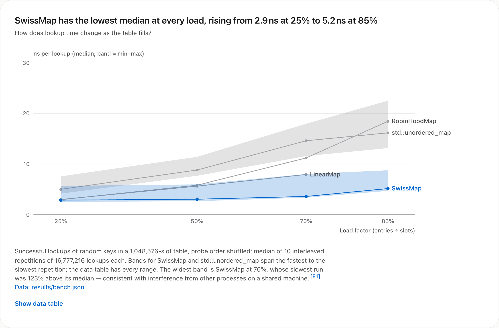

# hashbench

Three hash maps written from scratch in C++20 — linear probing, Robin Hood hashing and a Swiss-table design — checked against `std::unordered_map` and benchmarked on the same keys to show where each design wins.

**[Read the report →](https://allenwang0.github.io/hashbench/)** (methodology, percentiles, every number linked to its source)



## Highlights

<!-- results:start -->
- **4.05× faster lookups** for SwissMap than `std::unordered_map` at 70% full: 3.6 ns vs 14.6 ns, random keys, median of 10 runs on an Apple M5 Pro.
- **SIMD-style probing in plain C++**: SwissMap checks 8 slots at once with bit tricks on one 64-bit integer, no CPU-specific instructions.
- **Fuzzed**: 12,000,000 random operations per map (20 seeds × 200,000 × 3 key shapes), checked step by step against `std::unordered_map`, also under ASan and UBSan.

| Table | Lookup, 70% load | Insert per key, 4,194,304 keys |
| --- | ---: | ---: |
| `LinearMap` | 8.0 ns | 24.8 ns |
| `RobinHoodMap` | 11.2 ns | 52.7 ns |
| `SwissMap` | 3.6 ns | 19.0 ns |
| `std::unordered_map` | 14.6 ns | 235 ns |

Random 64-bit keys; median of 10 runs. Spread and load average are in the report.
<!-- results:end -->

## Run it

```sh
scripts/setup.sh                     # local venv with pinned CMake and Ninja
source .venv/bin/activate
cmake --workflow --preset release    # build and run the tests
scripts/run_bench.sh                 # 10 repetitions, results/ + report (several minutes)
```

`scripts/make_report.py` rebuilds [site/index.html](site/index.html) and this README's table from `results/`.

## How it works

- All three maps store entries directly in one array (open addressing) and share one API.
- **LinearMap** checks the next slot on a collision. Simple and fast when sparse, slow once clusters form.
- **RobinHoodMap** lets a new key take the slot of one that sits closer to its home, keeping probe lengths even.
- **SwissMap** keeps one tag byte per slot and scans a group of tags before touching any keys.
- `std::unordered_map` gains on sequential keys: libc++ hashes an integer to itself, while these maps scramble keys on purpose.

## Limitations

- One machine and one compiler, on a shared machine under load; the report gives the load average and the min–max spread.
- Keys and values are fixed at `uint64_t`; no iterators or custom allocators.
