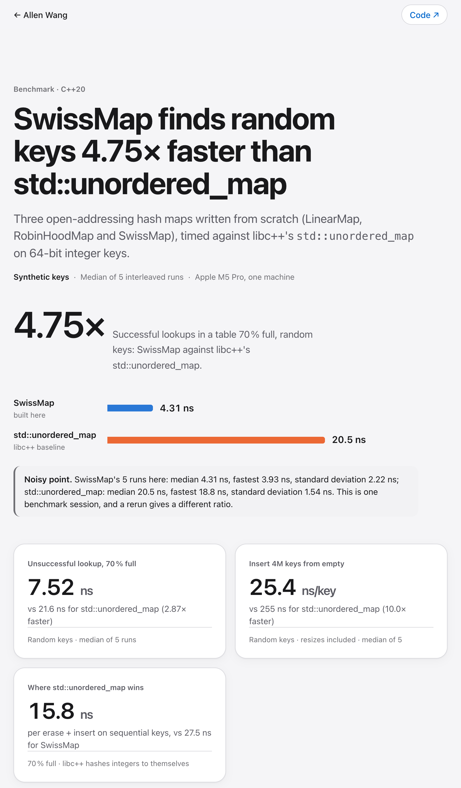

# hashbench

Three open-addressing hash maps written from scratch in C++20 (linear probing, Robin Hood hashing and a Swiss-table style group probe), fuzzed against `std::unordered_map` and benchmarked across load factors to show where each design wins and loses.



## Highlights

- **SwissMap hits in 3.9 ns** at load 0.70 on uniform random keys, against 18.8 ns for `std::unordered_map`, and still takes 5.2 ns at load 0.85.
- **Insert is 20.3 ns per key** for SwissMap when building 4,194,304 keys from empty, against 253.7 ns for `std::unordered_map`.
- **Portable SIMD-style probing**: SwissMap matches 8 control bytes at once with SWAR bit tricks on a `uint64_t`, with no SSE2 or NEON intrinsics.
- **Differential fuzzing**: 20 seeds x 200,000 random operations per table and key shape, checked step by step against `std::unordered_map`, also run under ASan and UBSan.

## Quickstart

Requires Python 3, a C++20 compiler and network access (CMake fetches GoogleTest and Google Benchmark).

```sh
scripts/setup.sh                     # .venv with pinned CMake, Ninja and tooling
source .venv/bin/activate
cmake --workflow --preset release    # build and run the 45 tests
cmake --workflow --preset sanitize   # same tests under ASan and UBSan
scripts/run_bench.sh                 # benchmarks + HTML report (about 4 minutes)
```

The full report is [site/index.html](site/index.html); open it locally. A dark-mode capture is in [docs/report-dark.png](docs/report-dark.png).

## Results

One run on an Apple M5 Pro, Apple clang 21 (`-O3 -DNDEBUG`, C++20), macOS. Keys and values are `uint64_t`, generated from seed 20261110. Lookups and churn run in a table fixed at 1,048,576 slots, so load factor is the only variable. Each number is the fastest of 5 interleaved repetitions. Raw output: [results/bench.json](results/bench.json), [results/latency.json](results/latency.json).

Time per operation in ns, uniform random keys, load 0.70 (the highest load all four tables support):

| Operation | SwissMap | LinearMap | RobinHoodMap | std::unordered_map |
| --- | ---: | ---: | ---: | ---: |
| Successful lookup | 3.9 | 9.6 | 14.2 | 18.8 |
| Unsuccessful lookup | 6.6 | 20.5 | 14.5 | 15.6 |
| Erase + insert (churn) | 29.6 | 43.4 | 73.5 | 216.6 |
| Insert 4,194,304 keys from empty, per key | 20.3 | 26.4 | 57.7 | 253.7 |

Per-lookup latency, uniform keys, load 0.70, ns. Each sample is a batch of 64 lookups divided by 64, because the clock tick on this machine is 41 ns.

| Table | Hit p50 | Hit p99 | Miss p50 | Miss p99 |
| --- | ---: | ---: | ---: | ---: |
| SwissMap | 4.5 | 6.5 | 6.5 | 10.4 |
| LinearMap | 9.8 | 13.7 | 18.9 | 37.8 |
| RobinHoodMap | 13.0 | 16.9 | 15.0 | 17.6 |
| std::unordered_map | 14.3 | 20.2 | 17.6 | 24.8 |

What the numbers show:

- **SwissMap** is fastest on every uniform-key lookup. At load 0.85 a hit takes 5.2 ns, against 20.9 ns for RobinHoodMap and 22.0 ns for `std::unordered_map`.
- **LinearMap** misses degrade fastest with load, from 4.2 ns at 0.25 to 20.5 ns at 0.70. A miss scans to the end of its cluster, and clusters grow quickly under linear probing.
- **RobinHoodMap** keeps miss latency tight (p50 15.0 ns, p99 17.6 ns at 0.70) but pays on writes: backward-shift deletion moves the rest of the cluster on every erase, and churn at load 0.85 costs 202.5 ns.
- **`std::unordered_map` wins on sequential keys**: 13.8 ns churn and 17.0 ns per key insert. libc++ hashes integers with the identity function, so consecutive keys land in consecutive buckets, while the open-addressing maps deliberately scatter them with splitmix64.
- During churn, LinearMap doubles capacity at starting loads of 0.50 and above, and SwissMap at 0.70 and above (`final_capacity` in `results/bench.json`), because tombstones count against the load limit.

## Design

All three maps share one API: `insert_or_assign`, `find` (pointer or `nullptr`), `contains`, `erase`, `size`, `capacity`, `load_factor`, `reserve`, `rehash`, `clear` and `for_each`. Capacity is a power of two, and keys pass through the splitmix64 finalizer ([include/hashbench/hash.h](include/hashbench/hash.h)) so keys that differ only in high bits do not collide.

| Table | Probe | Erase | Max load |
| --- | --- | --- | --- |
| [LinearMap](include/hashbench/linear_map.h) | next slot | tombstone | 0.70 |
| [RobinHoodMap](include/hashbench/robin_hood_map.h) | next slot, insert swaps with any entry closer to its home | backward shift, no tombstones | 0.875 |
| [SwissMap](include/hashbench/swiss_map.h) | aligned groups of 8 control bytes, triangular group order | `empty` if the group still has an empty slot, otherwise `deleted` | 0.875 |

- **Tombstones** (LinearMap, SwissMap) count toward the load limit. When an insert reaches the limit, the table rehashes in place if live entries are at most half the limit, and doubles otherwise, so a churn loop cannot fill the table with tombstones.
- **RobinHoodMap** stores each entry's probe distance in one byte. If an insert would need a longer distance, the table doubles instead.
- **SwissMap** uses SWAR on one `uint64_t` instead of intrinsics, so the same code runs on any 64-bit little-endian CPU. A `static_assert` rejects big-endian targets.

## Testing

- [tests/fuzz_test.cpp](tests/fuzz_test.cpp): 20 seeds x 200,000 random insert, overwrite, erase, find and clear operations per table and key shape (small range, clustered `k << 20`, full 64-bit), compared step by step with `std::unordered_map`, then a full content comparison.
- [tests/robin_hood_test.cpp](tests/robin_hood_test.cpp): after each of 30,000 operations, every entry sits exactly its recorded distance from home and distance grows by at most one per slot along a cluster.
- [tests/tombstone_test.cpp](tests/tombstone_test.cpp): 1,000,000 erase + insert cycles on 1,000 live keys keep capacity within 2x of the starting size, and a full Swiss group gets `deleted`, not `empty`, so later keys stay reachable.
- [tests/map_test.cpp](tests/map_test.cpp): typed tests for all three maps, including load-limit checks while growing from 16 slots to over 200,000 entries.

CI builds and tests with GCC 14 and Clang 18 on Linux and Apple clang on macOS.

## Limitations

- Benchmarks come from one machine and one compiler. The machine was shared during the run; taking the fastest of 5 interleaved repetitions removes most of that noise, but single repetitions varied by up to 41%.
- Latency percentiles are averaged over batches of 64 lookups, so they understate single-lookup outliers.
- `std::unordered_map` uses its default `std::hash` (identity on libc++), which differs from the hash the other three tables use.
- Keys and values are fixed at `uint64_t`; there is no iterator type and no custom allocator.

## License

MIT, see [LICENSE](LICENSE).
